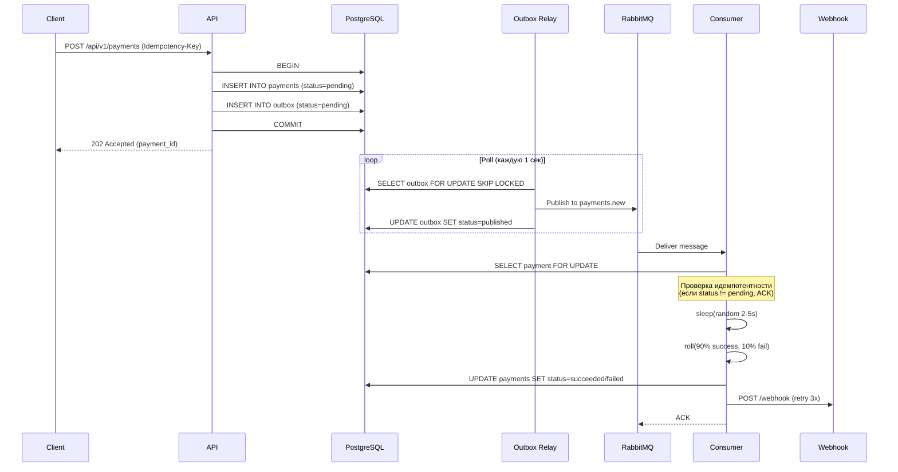

# Архитектура сервиса

Документ описывает ключевые архитектурные решения, паттерны и жизненный цикл данных в сервисе.

## Компоненты системы

1. **API (FastAPI)** - принимает запросы, валидирует их и сохраняет в БД.
2. **PostgreSQL** - основное хранилище (таблицы `payments` и `outbox`).
3. **Outbox Relay** - фоновый воркер, вычитывает события из таблицы `outbox` и публикует их в RabbitMQ.
4. **RabbitMQ** - брокер сообщений (очереди `payments.new` и `payments.new.dlq`).
5. **Consumer (FastStream)** - фоновый воркер, забирает сообщения из RabbitMQ, эмулирует обработку платежа и отправляет Webhook.

## Паттерн Transactional Outbox

Прямая отправка сообщения в RabbitMQ из API-метода.
**Решение:** При создании платежа записи в таблицы `payments` и `outbox` создаются в **одной транзакции** БД.
Событие в `outbox` имеет статус `pending`. Воркер `Outbox Relay` использует конструкцию `SELECT ... FOR UPDATE SKIP LOCKED`, забирает пачку событий и отправляет их в брокер.
Только после успешной отправки статус меняется на `published`.

## Схема обработки платежа

